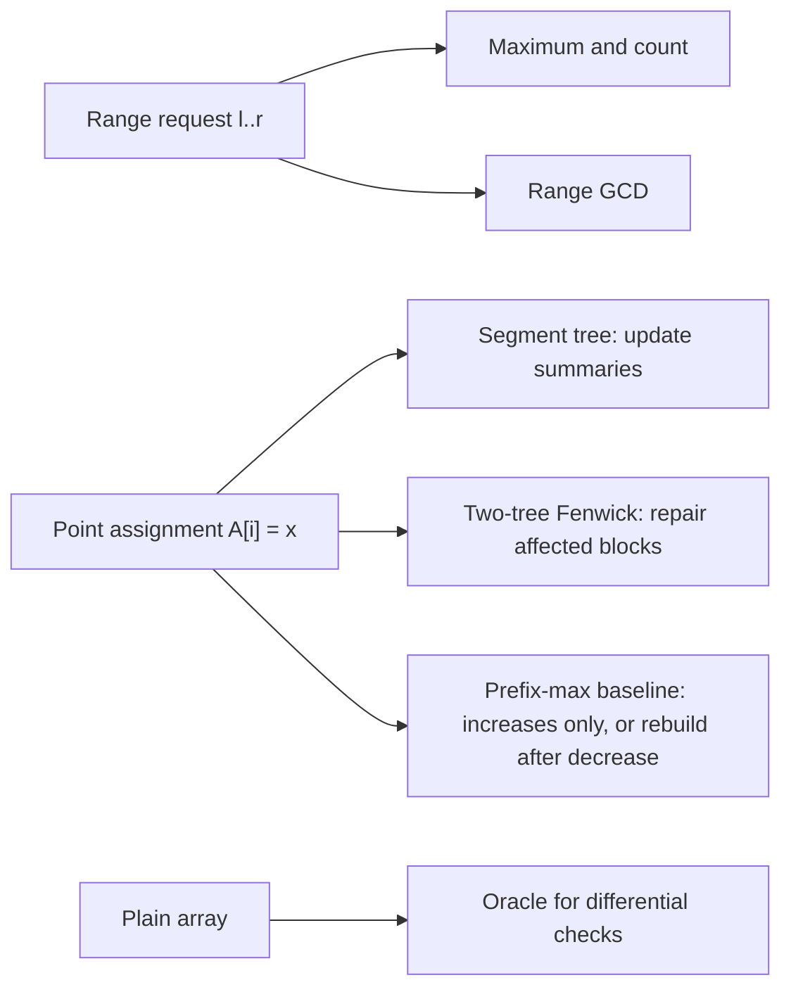
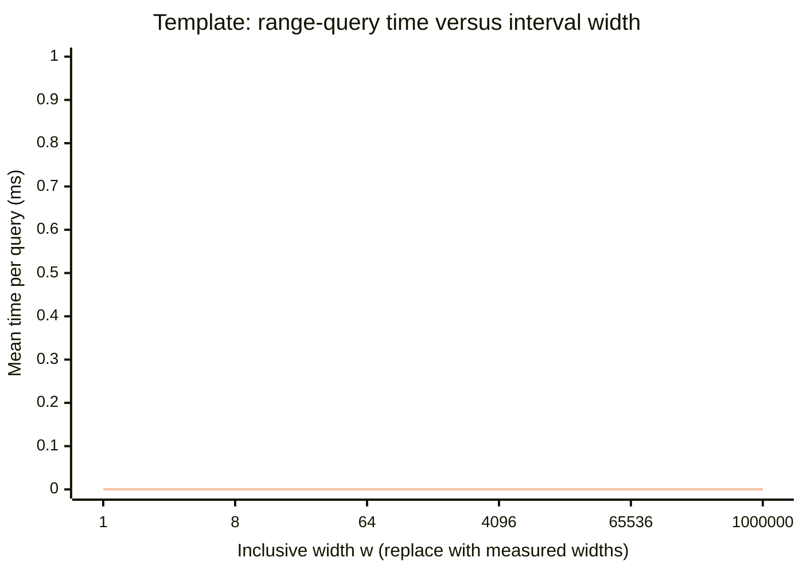
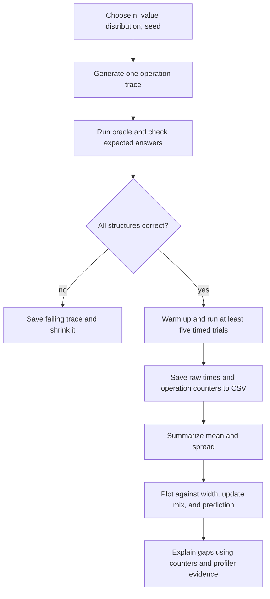

# Project 5 — Aggregates a Fenwick Tree Cannot Support

<!-- > **Working first draft — calculation-based prediction, before implementation timing.** The predicted costs below come from complexity analysis and counted work under stated workload assumptions. They are not timings from running the code. Replace `[TEAM…]` fields with team information. Later, measured results can be added in the separate validation sections. -->
<!-- 
## Project and team

| Field | Draft value |
|---|---|
| Course | CS 253 / MA 253 — Data Structures and Algorithms Laboratory |
| Project | 5: Aggregates a Fenwick Tree Cannot Support |
| Team / repository | `[TEAM NAME]` / `[REPOSITORY URL]` |
| Members and roles | `[NAMES AND SIX ASSIGNED ROLES]` |
| Implementation language | `[LANGUAGE AND VERSION]` |
| Evaluation / submission | 17 November 2026 / 21 November 2026 |
| Report status | Prediction written before measurement; results pending | -->

## 1. Executive summary

We study an array of sensor readings that receives point assignments, including assignments that lower a value. The application asks for (1) the maximum and its frequency on an interval and (2) the greatest common divisor (GCD) on an interval. The project compares a segment tree, the two-tree Dima–Ceterchi Fenwick range-maximum design, a prefix-maximum-only Fenwick baseline, and a plain-array oracle.

Our main prediction is calculated in abstract work units, not milliseconds. At $n=1{,}000{,}000$, the tree height is about 20 levels. Thus a segment-tree assignment recomputes about 20 ancestors, while a range query visits a number of canonical nodes proportional to 20. By contrast, the array oracle reads exactly $w$ elements for a width-$w$ query. The prefix-maximum Fenwick baseline has logarithmic prefix queries and updates only while values increase; a decrease can invalidate stored maxima and therefore requires a rebuild or another correct recovery strategy. The two-tree Fenwick range-maximum structure is expected to answer a range maximum in logarithmic work and to support decreases, but its update cost depends on how many stored blocks must be recomputed. We will calculate the structural growth first; later measurements can validate the prediction and estimate machine-specific constants.

The assignment requires a cost model before measuring, mean timing over at least five runs with spread, measurements against interval width and update mix, and an explanation of any regime where the Fenwick design wins. This draft supplies an analytical prediction and a separate future experiment plan. No code-running timings or profiler claims are presented as predictions.

## 2. Problem, interface, and correctness reference

The array has length $n$. A range is a **zero-based inclusive** interval $[l, r]$, with $0 \le l \le r < n$. Values are assumed to be non-negative integers unless the implementation documents a different input domain. An assignment sets $A[i] = x$; it is not an increment. Assignments may increase, decrease, or leave a value unchanged.

For each range, `range_max(l, r)` returns $(m, c)$, where $m$ is the largest value and $c$ is the number of positions attaining it. `range_gcd(l, r)` returns $\gcd(A[l], \ldots, A[r])$. The plain array scans the interval and serves as the correctness oracle for differential testing; it is not expected to be fast.

### Aggregate operation for maximum and frequency

Represent a segment by $(m, c)$. Define the combine operation $\otimes$ as:

$$
(m_1,c_1)\otimes(m_2,c_2)=
\begin{cases}
(m_1,c_1), & m_1>m_2,\\
(m_2,c_2), & m_2>m_1,\\
(m_1,c_1+c_2), & m_1=m_2.
\end{cases}
$$

Its identity is $e = (-\infty, 0)$. It is associative because combining summaries is exactly the summary (maximum, its multiplicity) of the concatenation of the represented segments, and concatenation is associative. This monoid supports segment-tree range aggregation without requiring an inverse. The implementation must ensure that its chosen representation of $-\infty$ cannot collide with a valid sensor value.

For GCD, combine with $\gcd(a,b)$ and identity $0$; $\gcd(0,x)=|x|$. GCD is associative, so the same segment-tree shape can use this monoid separately.

### Why prefix subtraction does not give a range maximum

For sums, $\operatorname{sum}(l,r) = \operatorname{prefix}(r) - \operatorname{prefix}(l-1)$ works because addition has an inverse. Maximum has no inverse: knowing the maximum of $[0,r]$ and $[0,l-1]$ does not reveal the maximum after removing the prefix. For example, prefix maxima $[9,9]$ are compatible with a suffix whose maximum is either $9$ or $2$. Thus a conventional prefix-max Fenwick tree cannot answer arbitrary range maxima by subtraction. The two-tree design uses a different range-query construction.

## 3. Structures included in the comparison

| Label | Purpose | Expected supported work | Correctness / scope note |
|---|---|---|---|
| `SEG-MAX` | Segment tree over $(maximum, count)$ | Range maximum and count; point assignment | $O(\log n)$ combine/visit work per query or assignment |
| `SEG-GCD` | Segment tree over GCD | Range GCD; point assignment | $O(\log n)$ combine/visit work per query or assignment |
| `DC-MAX` | Dima–Ceterchi two-tree Fenwick range-maximum design | Range maximum; point assignments including decreases | Count query steps, updated blocks, and recomputation work; confirm count support in the implemented variant |
| `BIT-PREFIX-MAX` | Prefix-maximum-only Fenwick baseline | Prefix maximum; range use only where valid, or by documented rebuild strategy | Increase-only update rule is not correct for arbitrary decreases |
| `ARRAY` | Plain-array oracle | All requested operations | $O(w)$ range scan for width $w=r-l+1$; assignment $O(1)$ |

**GCD scope:** The assignment specifies the segment tree for both monoids and describes Structure B as a range-maximum structure. Unless the team has implemented and proved an additional valid GCD method, do not report `DC-MAX` or `BIT-PREFIX-MAX` as supporting range GCD. Likewise, any `BIT-PREFIX-MAX` range result produced after a decrease must be labeled with the actual rebuild/recovery work; a stale prefix maximum is incorrect.

## 4. D6 — Analyst's predicted-cost model

### 4.1 Cost dimensions

For each operation, record both elapsed time and implementation-independent work counters. Let:

- $n$ = number of array elements;
- $w = r-l+1$ = queried range width;
- $Q$ = number of range queries; $U$ = number of point assignments;
- $p$ = fraction of assignments that are decreases; $1-p$ is the increase fraction (unchanged assignments are tracked separately);
- $C$ = number of aggregate combines; $V$ = number of tree/Fenwick cells visited;
- $R$ = number of stored summaries recomputed during a `DC-MAX` assignment; $S$ = lower-level scan/merge steps used by those recomputations;
- $B$ = number of cells rebuilt in the prefix-only baseline;
- $M$ = bytes allocated for the structure, excluding the shared input unless reported separately.

We use a simple time model to separate fixed overhead from algorithmic work:

$$
T \approx \alpha + \beta_C C + \beta_V V + \beta_S S + \beta_B B + \beta_w w + \epsilon,
$$

where the coefficients are implementation- and machine-dependent and `ε` includes timer noise, scheduling, and cache effects. Fit or estimate coefficients only after collecting data. Big-O bounds below describe growth, not a promise that a particular implementation will be faster.

### 4.2 Per-operation predictions

| Variant / operation | Predicted work | Asymptotic prediction | Important measured counters |
|---|---:|---:|---|
| `SEG-MAX` range query | Visit canonical segment nodes and combine summaries; at most a constant number per tree level | $O(\log n)$ | nodes visited, combines |
| `SEG-MAX` assignment | Replace leaf and recompute ancestors | $O(\log n)$ | ancestors recomputed, combines |
| `SEG-GCD` range query | Visit canonical segment nodes and combine GCDs | $O(\log n)$ tree combines; each GCD has value-dependent Euclid cost | nodes, GCD calls, Euclid iterations |
| `SEG-GCD` assignment | Replace leaf and recompute ancestors | $O(\log n)$ GCD calls; value-dependent Euclid work | ancestors, GCD calls, Euclid iterations |
| `DC-MAX` range query | Walk the two Fenwick structures according to the published algorithm | $O(\log n)$ steps, as required by project D2 | cells visited, comparisons, combines |
| `DC-MAX` assignment | Update affected blocks and repair summaries | Counted as `R` recomputations plus `S` internal work; prediction to verify is at most polylogarithmic, with adversarial decreases stressing the worst case | affected cells, summaries recomputed, scan/merge steps |
| `BIT-PREFIX-MAX` prefix query | Follow Fenwick prefix decomposition | $O(\log n)$ | cells visited, comparisons |
| `BIT-PREFIX-MAX` increase assignment | Propagate through update path | $O(\log n)$ | cells changed |
| `BIT-PREFIX-MAX` decrease assignment | Correctness requires recovery; a full rebuild is $O(n)$ if that is the chosen policy | $O(n)$ per rebuild, plus the triggering update | rebuilt cells, rebuild count |
| `ARRAY` range query | Inspect each element in the interval | $\Theta(w)$ | elements inspected |
| `ARRAY` assignment | Write one element | $\Theta(1)$ | writes |

For `DC-MAX`, the assignment gives the correctness and $O(\log n)$ query target but does not itself state a point-update worst-case formula. The report must not silently claim a tighter bound than the implemented Dima–Ceterchi update procedure proves. D2 should establish that bound; the benchmark should then test its constants and worst-case behavior. The counters $R$ and $S$ make the model useful even if the update has multiple nested loops.

### 4.3 Workload-level prediction

For `Q` maximum queries and `U` assignments, the segment-tree work is predicted as:

$$
W_{SEG-MAX}=\Theta((Q+U)\log n),
\qquad
W_{SEG-GCD}=\Theta((Q_g+U)\log n)\text{ GCD combines},
$$

where $Q_g$ is the number of GCD queries. The wall time for GCD also depends on the operands; it should be accompanied by the Euclid-iteration counter.

For the array oracle, if query $j$ has width $w_j$:

$$
W_{ARRAY}=\Theta\!\left(U+\sum_{j=1}^{Q} w_j\right).
$$

If widths are approximately uniform at $w$, this is $\Theta(U+Qw)$. This predicts that the oracle can be competitive for very short intervals despite its linear worst case, and should lose as intervals widen.

For `DC-MAX`, use observed counters in the explanatory model:

$$
W_{DC-MAX}=\sum_{j=1}^{Q} V^{(q)}_j + \sum_{i=1}^{U}\left(R_i+S_i\right).
$$

The query target is logarithmic. Update behavior is reported as the distribution and maximum of $R_i$ and $S_i$, split by increase/decrease and workload. This exposes whether repeated decreases cause substantially more repair work than increases.

For the prefix-only baseline, a policy that rebuilds after each decrease has approximate work:

$$
W_{BIT-PREFIX-MAX}=\Theta(Q\log n + U_{inc}\log n + Dn),
$$

where `D` is the number of decreases that trigger a full rebuild. If the implementation uses a different recovery method, substitute its actual counters and prove its correctness. This baseline is included to demonstrate the limitation, not to imply that the rebuild approach is the recommended solution.

### 4.4 GCD range-query bound and value dependence

The segment tree uses $O(\log n)$ canonical summaries for a range query. Each summary combination invokes Euclid's algorithm. For $V=\max_i |A[i]|$, one GCD takes $O(\log V)$ divisions in the general worst case, giving the straightforward upper bound $O(\log n \cdot \log V)$ for GCD work.

The tighter project target $O(\log n + \log V)$ relies on telescoping: as the range is covered by successively combined segment summaries, a nontrivial GCD strictly decreases by at least a factor of two after at most two Euclid steps. Therefore the value-dependent Euclid work accumulated across the query is bounded by $O(\log V)$, in addition to $O(\log n)$ tree traversal and combine overhead. The team should include the full proof in D3 and validate that the implementation's query order matches the proof. Record both tree combines and Euclid iterations so the experiment can distinguish these costs.

### 4.5 Crossover interpretation

For a range query, the array scan costs approximately $a + b\cdot w$; a tree query costs approximately $c + d\cdot\log_2 n$, where constants include branch, memory, and aggregate-combine costs. The predicted crossover width is therefore:

$$
w^* \approx \frac{c-a+d\log_2 n}{b}.
$$

This is a hypothesis to estimate from measurements, not a known universal number. For short ranges, sequential array reads may be cache-friendly; for broad ranges, the oracle does proportionally more work. Likewise, `DC-MAX` may win in some update/query mixtures if its constants and repair work are favorable, but that is an empirical result. We will not infer a cache advantage without profiler output.

### 4.6 Worked calculation at the required scale

The following is a **predicted count of logical work**, calculated from $n=1{,}000{,}000$ and $10^6$ operations. It is not elapsed time. For an ordinary segment tree, $\lceil\log_2 n\rceil=20$; a range query can visit up to roughly two boundary paths (about 40 boundary/canonical-node steps as a conservative planning estimate), and an assignment updates about 20 ancestors. Exact counts depend on tree layout, interval endpoints, and whether the implementation counts leaves, identity combines, or loop iterations.

For a million range queries all having the same inclusive width $w$, the plain-array oracle reads exactly $10^6\cdot w$ array elements. A segment tree performs on the order of $10^6\cdot 40 = 40{,}000{,}000$ query-path/node steps under the conservative estimate. The simple comparison below makes the key width effect visible:

| Inclusive range width $w$ | Oracle element reads for $10^6$ queries | Segment-tree query path work (planning estimate) | Prediction |
|---:|---:|---:|---|
| 1 | 1,000,000 | about 40,000,000 node/path steps | Oracle does less abstract query work; likely favorable for tiny ranges, before constant and memory effects |
| 8 | 8,000,000 | about 40,000,000 node/path steps | Oracle still does fewer counted data inspections |
| 64 | 64,000,000 | about 40,000,000 node/path steps | Similar order; tree asymptotics begin to be favorable as widths grow |
| 62,500 ($n/16$) | 62,500,000,000 | about 40,000,000 node/path steps | Tree uses far fewer logical visits |
| 500,000 ($n/2$) | 500,000,000,000 | about 40,000,000 node/path steps | Tree strongly favored by operation count |
| 1,000,000 ($n$) | 1,000,000,000,000 | about 40,000,000 node/path steps | Tree strongly favored by operation count |

These are counts of different primitive actions (array reads versus tree-node/path steps), so they are not a direct speed ratio. A sequential array read can be cheaper than a tree step. The table predicts growth and suggests where the crossover may lie; only later timing can establish the crossover on the team's machine.

For a mixed workload with $10^6$ total operations, 50% queries, 50% assignments, and query width 64, the same calculation predicts:

| Variant | Calculation | Approximate predicted logical work |
|---|---|---:|
| `ARRAY` | $500{,}000 \times 64$ element reads + $500{,}000$ writes | 32,500,000 reads/writes |
| `SEG-MAX` | $500{,}000 \times 40$ query steps + $500{,}000 \times 20$ ancestor updates | 30,000,000 path/node steps, plus combines |
| `DC-MAX` | $500{,}000 \times$ (query steps per published algorithm) + the sum of measured-by-counter repair steps $R_i+S_i$ | Query component is logarithmic; assignment component must use the proved update bound and the adversarial repair count |
| `BIT-PREFIX-MAX` with full rebuild after each decrease | $Q\cdot20 + U_{inc}\cdot20 + D\cdot1{,}000{,}000$ | Depends on decrease count $D$; at 10% decreases among the 500,000 assignments, rebuilds alone visit about 50,000,000,000 cells |

The last row assumes one complete `n`-cell rebuild per decreasing assignment. If the team's baseline uses another correct recovery method, recalculate from its actual work. This example explains why even a modest decrease fraction can dominate the prefix-only baseline under a rebuild policy. It is a prediction derived from the stated policy, not a measurement.

For GCD, a segment-tree query visits $O(\log n)$ summaries, and each merge invokes GCD. The elementary upper-bound calculation is about 40 summary/path steps and at most $O(\log V)$ Euclid divisions per merge. D3's telescoping argument tightens accumulated value-dependent work to $O(\log V)$ across the query, yielding $O(\log n + \log V)$. Therefore the report should predict both the structural steps (about 20 levels) and the value-dependent Euclid iteration total; it should not multiply two worst-case maxima as if they necessarily occur together after the D3 proof.

For the two-tree Fenwick design, $\log_2(1{,}000{,}000)\approx19.93$, so its target logarithmic query work is on a scale of about 20 levels, multiplied by the algorithm's per-level operations. The project brief does not provide the per-level constant or the exact worst-case update count. Those must come from D2 and the implemented algorithm, rather than an invented numerical estimate. The analyst can still make a useful prediction: queries should grow logarithmically with $n$, while decrease updates are the likely high-work case and must be modeled by the D2 recurrence/recomputation bound.

## 5. Benchmark and measurement plan

### 5.1 Controls and reporting

1. Use the same language, compiler, optimization settings, value arrays, operation traces, and seeds across applicable structures.
2. Build structures before timing query/update batches; report construction time separately. Report rebuild time when the prefix-only baseline rebuilds.
3. Warm up once, then collect at least five timed runs per configuration. Report the arithmetic mean and spread (minimum–maximum and standard deviation, or another clearly named spread measure).
4. Record the machine model, processor, cache sizes, operating system, compiler and version, flags, and thread/power conditions.
5. Record each random seed used to generate a trace. Store raw per-run measurements as CSV under `results/` and scripts used to produce figures.
6. Validate each trace against the array oracle before interpreting performance. Exclude correctness failures from timing comparisons and report them as failures.
7. At full scale, use at least $10^6$ array elements and $10^6$ operations, as required for in-memory structures. Keep a smaller scale only as an additional diagnostic.
8. Cache claims require profiler output. If profiling is unavailable, report timing and counters without attributing a cause to cache behavior.

### 5.2 Experiment matrix

Use independent runs for maximum queries and GCD queries where a structure does not support both. $w/n$ is the interval-width fraction; choose valid endpoints so the measured width is the actual inclusive width.

| ID | $n$ | Operations | Widths | Update mix | Purpose | Seed / status |
|---|---:|---:|---|---|---|---|
| E1 | $10^6$ | $10^6$ | 1, 8, 64, $n/16$, $n/2$, $n$ | no updates | Query cost vs width; array/tree crossover | `[SEED] / pending` |
| E2 | $10^6$ | $10^6$ | uniform random | 0%, 10%, 50%, 90% assignments | Query/update mix | `[SEED] / pending` |
| E3 | $10^6$ | $10^6$ | uniform random | 100% increases | Fenwick increase path | `[SEED] / pending` |
| E4 | $10^6$ | $10^6$ | uniform random | 100% decreases | Decrease repair cost | `[SEED] / pending` |
| E5 | $10^6$ | $10^6$ | selected to maximize documented step count | mixed; emphasize adversarial decreases | Project adversarial target: recomputation and query steps | `[SEED] / pending` |
| E6 | $10^6$ | $10^6$ | short and full-width | repeated decreases to same/update-neighboring regions | Prefix baseline rebuild cost and correctness limitation | `[SEED] / pending` |
| E7 | $10^6$ | $10^6$ | uniform random and adversarial | mixed values with repeated/equal maxima | Count-of-maximum correctness and cost | `[SEED] / pending` |
| E8 | $10^6$ | $10^6$ | uniform random | varied values, including zeros and large values | GCD operand and Euclid iteration sensitivity | `[SEED] / pending` |

Document value distributions explicitly (for example, bounded uniform values, repeated plateaus, powers of two, or Fibonacci-like values for Euclid stress). Avoid changing distributions between variants within one comparison. Adversarial inputs should be reproducible and tied to the project's D5 constructions.

### 5.3 Timing and output tables (this is a templelate I will fill this out after anaykysiis n actual data and tests and all...)

**Machine and compiler (fill before measurements):**

| Item | Recorded value |
|---|---|
| CPU / model | `[MEASURE]` |
| Core count / frequency policy | `[MEASURE]` |
| Cache sizes (L1/L2/L3) | `[MEASURE]` |
| RAM / OS | `[MEASURE]` |
| Compiler and version | `[MEASURE]` |
| Build flags | `[MEASURE]` |
| Profiler and command | `[MEASURE OR NOT AVAILABLE]` |

**Results table — fill with means and spread from at least five runs:**

| Experiment | Variant | Mean time (ms) | Spread (ms or stated measure) | Work counters | Correct? |
|---|---|---:|---:|---|---|
| E1, width 1 | `ARRAY` | `[MEASURE]` | `[MEASURE]` | elements `[MEASURE]` | `[Y/N]` |
| E1, width 1 | `SEG-MAX` | `[MEASURE]` | `[MEASURE]` | visits/combines `[MEASURE]` | `[Y/N]` |
| E1, width 1 | `DC-MAX` | `[MEASURE]` | `[MEASURE]` | steps `[MEASURE]` | `[Y/N]` |
| E1, width n | `ARRAY` | `[MEASURE]` | `[MEASURE]` | elements `[MEASURE]` | `[Y/N]` |
| E1, width n | `SEG-MAX` | `[MEASURE]` | `[MEASURE]` | visits/combines `[MEASURE]` | `[Y/N]` |
| E4 / E5 | `DC-MAX` | `[MEASURE]` | `[MEASURE]` | repair `R,S` `[MEASURE]` | `[Y/N]` |
| E6 | `BIT-PREFIX-MAX` | `[MEASURE]` | `[MEASURE]` | rebuilds/cells `[MEASURE]` | `[Y/N]` |
| E8 | `SEG-GCD` | `[MEASURE]` | `[MEASURE]` | combines/Euclid steps `[MEASURE]` | `[Y/N]` |

### 5.4 Figures to generate from the raw CSV (this is a tempelate will fill after anlysis results later...)

Include the plotted points and uncertainty/spread bars, plus axes, units, workload, and seed in each caption. Suggested plots:

1. **Range-query time vs width** (log-scaled width axis): `ARRAY`, `SEG-MAX`, and `DC-MAX`.
2. **Assignment time vs decrease fraction**: segment tree and two-tree Fenwick, with ordinary and adversarial traces separated.
3. **Recomputation work vs update index** for adversarial decreases, with maximum and percentile summaries.
4. **Predicted vs measured work**: predicted counter totals versus observed counters, and a separate measured-time plot. Keep model predictions distinct from elapsed-time data.
5. **GCD query time and Euclid steps vs value range** for `SEG-GCD`.

The chart above is an **empty plotting template**, not experimental data. Replace the zero placeholders from the recorded CSV or remove this block and insert a generated figure.

## 6. Predicted versus measured analysis

Complete this section after running the benchmarks.

| Prediction | Measurement to compare | Result / explanation |
|---|---|---|
| `ARRAY` query work grows linearly with `w` | elements inspected and time vs width | `[FILL AFTER MEASUREMENT]` |
| Segment-tree query/update work grows with $\log_2 n$ | visited nodes / recomputed ancestors vs $n$ | `[FILL AFTER MEASUREMENT]` |
| `DC-MAX` query uses logarithmic steps | visited cells vs $n$ and width | `[FILL AFTER MEASUREMENT]` |
| `DC-MAX` decreases can cause extra repair work | `R,S` distributions by update type and adversary | `[FILL AFTER MEASUREMENT]` |
| Prefix-only baseline cannot safely apply a decrease using its increase rule | differential test and chosen recovery behavior | `[FILL AFTER MEASUREMENT]` |
| GCD value work follows the D3 bound | Euclid iterations vs `n` and `V` | `[FILL AFTER MEASUREMENT]` |

**Observed crossover, if any:** `[WIDTH / WORKLOAD / VARIANTS / UNCERTAINTY]`

**Largest prediction gap and likely measured cause:** `[COUNTERS, PROFILER EVIDENCE, OR STATE THAT CAUSE IS UNKNOWN]`

**Does the two-tree Fenwick structure win in any tested regime?** `[ANSWER FROM RESULTS; INCLUDE QUERY/UPDATE MIX AND SPREAD]`

## 7. Adversarial cases and correctness checks

| Case | What it targets | Expected check |
|---|---|---|
| Repeated decreasing assignments to a current range/block maximum | Dima–Ceterchi summary repair work | Results remain equal to oracle; report maximum and distribution of `R,S` |
| Query endpoints chosen for maximum traversal steps | Fenwick range-query path | Count steps and compare result with oracle |
| Decrease the unique maximum in a prefix | Prefix-max invalidation | Demonstrate that increase-only propagation leaves stale data unless repaired |
| Equal maxima on both sides of a segment split | Frequency tie handling | Return correct maximum and combined count |
| All values equal; single-element ranges; full-array range | Boundary and count behavior | Match oracle |
| GCD inputs including zero, ones, repeated factors, and large coprime values | GCD identity and Euclid cost | Match oracle; count Euclid iterations |
| First/last index assignments and queries | Index boundaries | No out-of-range access; match oracle |

The oracle/differential harness should run the assignment-required one million seeded operations and shrink any failure to a minimal sequence. State the seed, input domain, and invariant checks in the final report. The release tested by the examiner is the commit tagged `final`.

## 8. Visual summary of the benchmark process

## 9. Limitations and assumptions

- This is a pre-measurement model. Constants, crossover widths, and actual winners are not known yet.
- `DC-MAX` update complexity must be stated consistently with the team's implementation and D2 proof. This report uses explicit repair counters instead of inventing a bound.
- The project asks for maximum plus multiplicity. Verify that the implemented two-tree Fenwick variant maintains multiplicity correctly under ties and decreases; if it only returns the maximum value, document that gap and do not claim full application support.
- A standard prefix-maximum Fenwick tree is a baseline with a restricted update rule. Any decrease recovery policy must be included in both correctness and timing.
- The tight GCD bound depends on the D3 telescoping proof and its assumptions about values and merge order. Present the complete proof in the derivation file.
- Cache behavior is not inferred from timing alone. Cite profiler output or leave the explanation at the level of observed work and timing.
- Report all missing metadata and deviations from this plan, including reduced sizes, unavailable profiler runs, or workload changes.

<!-- ## 10. Submission checklist

- [ ] `REPORT.md` contains the design, D6 model, figures, measured comparison, and adversarial results.
- [ ] `INTERFACE.md` defines common operations and structural invariants.
- [ ] `docs/derivations/D1.pdf` through `D6.pdf` name their authors and include proofs.
- [ ] `TOOLS.md` declares AI and other tools, what they generated, and what the team changed afterward.
- [ ] Same-language implementations of both structures and the array oracle are included.
- [ ] Differential test, invariant checks, adversarial generators, and benchmark harness are present.
- [ ] At least $10^6$ elements and $10^6$ operations are exercised at full scale.
- [ ] Each timing is a mean of at least five runs with spread; machine, compiler, flags, and seeds are recorded.
- [ ] Raw CSV logs and figure-generation scripts are committed under `results/`.
- [ ] Each member has a branch and a pull request reviewed by another member; commit history is distributed across the project period.
- [ ] Final demonstration runs from a fresh clone of the release tagged `final`. -->

## References

1. P. M. Fenwick, “A new data structure for cumulative frequency tables,” *Software: Practice and Experience*, 24(3), 327–336, 1994.
2. M. Dima and R. Ceterchi, “Efficient range minimum queries using binary indexed trees,” *Olympiads in Informatics*, 9, 39–44, 2015. The project applies a range-maximum variant; cite the exact variant and any transformation used in D2.
3. M. de Berg, O. Cheong, M. van Kreveld, and M. Overmars, *Computational Geometry: Algorithms and Applications*, 3rd ed., Springer, 2008, Chapter 10.
4. J. L. Bentley, “Decomposable searching problems,” *Information Processing Letters*, 8(5), 244–251, 1979.
5. D. E. Knuth, *The Art of Computer Programming*, Vol. 2, 3rd ed., Addison-Wesley, 1997, §4.5.3.
6. cp-algorithms, “Segment Tree” and “Fenwick Tree,” study material listed in the project brief. `[Add access date/version if required by the course.]
