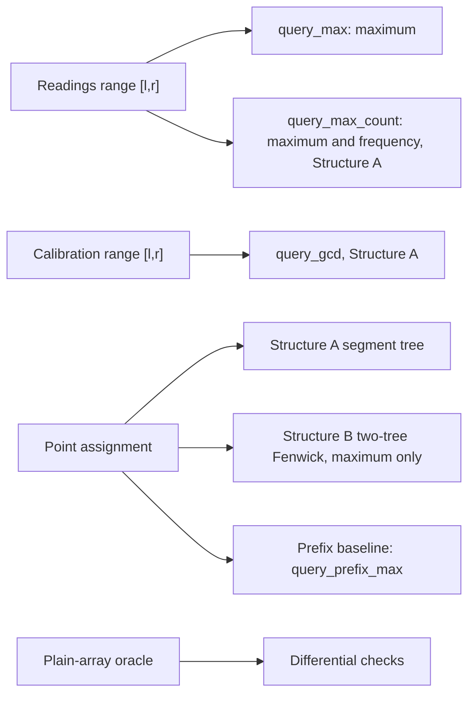
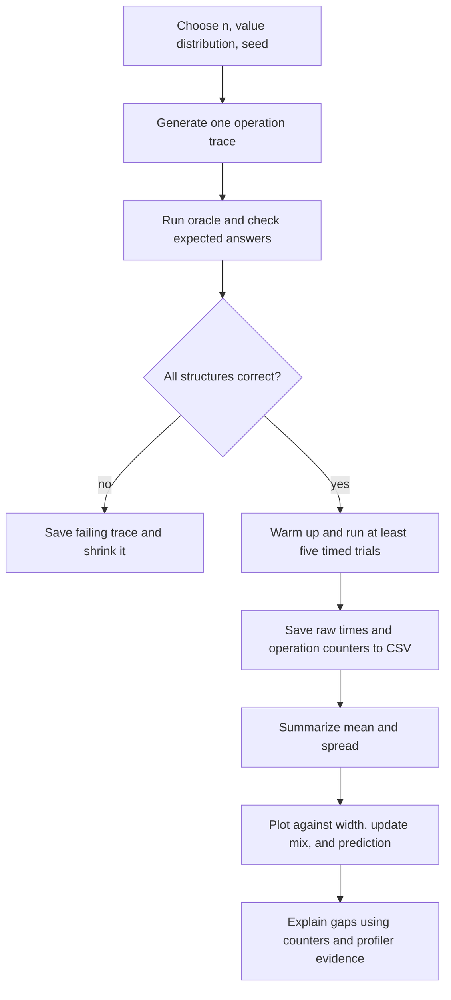

# Project 5 — Aggregates a Fenwick Tree Cannot Support

<!-- > **Working first draft — calculation-based prediction, before implementation timing.** The predicted costs below come from complexity analysis and counted work under stated workload assumptions. They are not timings from running the code. Replace `[TEAM…]` fields with team information. Later, measured results can be added in the separate validation sections. -->
<!-- 
## Project and team

| Field | Draft value |
|---|---|
| Course | CS 253 / MA 253 — Data Structures and Algorithms Laboratory |
| Project | 5: Aggregates a Fenwick Tree Cannot Support |
| Team / repository | `[TEAM NAME]` / `[REPOSITORY URL]` |
| Members and roles | `[NAMES AND SIX ASSIGNED ROLES]` |
| Implementation language | `[LANGUAGE AND VERSION]` |
| Evaluation / submission | 17 November 2026 / 21 November 2026 |
| Report status | Prediction written before measurement; results pending | -->

## 1. Executive summary

We study two separate arrays: sensor readings, used for range maximum, and calibration factors, used for range GCD. Point assignments may lower a value. Structure A is a segment tree supporting `query_max`, `query_max_count`, and `query_gcd` on the appropriate arrays. Structure B is the two-tree Dima–Ceterchi structure supporting range maximum only; it does not return the maximum's frequency. We compare A and B on identical `query_max` workloads, evaluate A's `query_max_count` and `query_gcd` separately against the oracle, and evaluate the prefix-only Fenwick baseline with its actual `query_prefix_max` interface.

Our main prediction is calculated in abstract work units, not milliseconds. At $n=1{,}000{,}000$, the tree height is about 20 levels. Thus a segment-tree assignment recomputes about 20 ancestors, while a range query visits a number of canonical nodes proportional to 20. By contrast, the array oracle reads exactly $w$ elements for a width-$w$ query. A decrease can invalidate prefix-maximum summaries, so the baseline must rebuild affected cells; the amount of repair depends on the update sequence. The two-tree Fenwick range-maximum structure is expected to answer a range maximum in logarithmic work and to support decreases, but its update cost depends on how many stored blocks must be recomputed. We will calculate the structural growth first; later measurements can validate the prediction and estimate machine-specific constants.

The assignment requires a cost model before measuring, mean timing over at least five runs with spread, measurements against interval width and update mix, and an explanation of any regime where the Fenwick design wins. This draft supplies an analytical prediction and a separate future experiment plan. No code-running timings or profiler claims are presented as predictions.

## 2. Problem, interface, and correctness reference

The readings array and calibration array each have length $n$. Positions and nonempty ranges follow [the shared interface](INTERFACE.md): positions are **1-based** and ranges are **closed** $[l,r]$, where $1\le l\le r\le n$. The interface also permits an empty range with $l=r+1$; the width formulas in this report apply to nonempty ranges. An assignment sets the selected position to a value; it is not an increment. Assignments may increase, decrease, or leave a value unchanged. Readings and calibration factors are distinct arrays and are updated and queried through their respective structures.

For a readings range, `query_max(l, r)` returns only the largest value, while `query_max_count(l, r)` returns $(m,c)$: the maximum and its frequency. Structure B implements `query_max`; it is not required to implement `query_max_count`. For a calibration range, `query_gcd(l, r)` returns its GCD. The plain-array oracle supports these operations by scanning the corresponding input array and serves as the correctness reference.

### Aggregate operation for maximum and frequency

Represent a segment by $(m, c)$. Define the combine operation $\otimes$ as:

$$
(m_1,c_1)\otimes(m_2,c_2)=
\begin{cases}
(m_1,c_1), & m_1>m_2,\\
(m_2,c_2), & m_2>m_1,\\
(m_1,c_1+c_2), & m_1=m_2.
\end{cases}
$$

Its identity is $e = (-\infty, 0)$. It is associative because combining summaries is exactly the summary (maximum, its multiplicity) of the concatenation of the represented segments, and concatenation is associative. This monoid supports segment-tree range aggregation without requiring an inverse. The implementation must ensure that its chosen representation of $-\infty$ cannot collide with a valid sensor value.

For GCD, combine with $\gcd(a,b)$ and identity $0$; $\gcd(0,x)=|x|$. GCD is associative, so Structure A can use the same segment-tree shape separately over the calibration array.

### Why prefix subtraction does not give a range maximum

For sums, define $P(k)=\sum_{i=1}^{k} a_i$ and $P(0)=0$. For a closed, 1-based range $[l,r]$,

$$
S(l,r)=P(r)-P(l-1).
$$

The two prefixes are over $[1,r]$ and $[1,l-1]$; the second is empty when $l=1$. This subtraction works because addition has an inverse. Maximum has no inverse: knowing the maximum of $[1,r]$ and $[1,l-1]$ does not reveal the maximum after removing the earlier prefix. For example, prefix maxima of $9$ on both $[1,4]$ and $[1,8]$ do not reveal whether the maximum on $[5,8]$ is $9$ or $2$. Thus `query_prefix_max` values cannot be subtracted to answer arbitrary range-maximum queries. The two-tree design uses a different range-query construction.

## 3. Structures included in the comparison

| Label | Purpose | Expected supported work | Correctness / scope note |
|---|---|---|---|
| `SEG-MAX-COUNT` | Structure A segment tree over $(maximum, count)$ for readings | `query_max`, `query_max_count`; point assignment | $O(\log n)$ combines/visits per query or assignment |
| `SEG-GCD` | Structure A segment tree over calibration factors | `query_gcd`; point assignment | $O(\log n)$ combines per query or assignment, with value-dependent GCD work |
| `DC-MAX` | Structure B Dima–Ceterchi two-tree Fenwick | `query_max`; point assignments including decreases | Compare with A on identical max-only queries; count steps and repair work |
| `BIT-PREFIX-MAX` | Prefix-maximum Fenwick baseline | `query_prefix_max`; point assignment | Compare on prefix queries; do not treat it as an arbitrary-range max structure |
| `ARRAY` | Plain-array oracle over readings and calibration factors | Oracle versions of the interface operations | $O(w)$ scan for a nonempty range of width $w$; assignment $O(1)$ |

**Comparison scope:** Structure B returns a maximum value, not a frequency; only compare `query_max` on identical traces between A and B. Measure `query_max_count` for A and the oracle separately. Structure B and the prefix baseline do not support range GCD. Compare the prefix baseline using `query_prefix_max` on matching prefix endpoints. Its invariant must remain correct after decreases; the agreed interface rebuilds affected cells and increments the recomputation counter.

## 4. D6 — Analyst's predicted-cost model

### 4.1 Cost dimensions

For each operation, record both elapsed time and implementation-independent work counters. Let:

- $n$ = number of array elements;
- $w = r-l+1$ = queried range width;
- $Q$ = range-query count for the current workload; $Q_{max}$, $Q_{count}$, $Q_{gcd}$, and $Q_p$ = counts of `query_max`, `query_max_count`, `query_gcd`, and `query_prefix_max`; $U$ = number of point assignments;
- $U_{inc}$ and $D$ = numbers of increasing and decreasing assignments, respectively;
- $V_{max}$ = largest absolute calibration factor (the $V$ used in the GCD bound);
- $p$ = fraction of assignments that are decreases; $1-p$ is the increase fraction (unchanged assignments are tracked separately);
- $B_i$ = per-assignment delta of `OpCounters.recomputations` (cells rebuilt);
- $R_i$, $W_i$, and $C_i$ = per-assignment deltas of `node_reads`, `node_writes`, and `combines`, respectively;
- $B$ = total recomputations; $R$ = total node reads; $W$ = total node writes; $C$ = total combines;
- $M$ = bytes allocated for the structure, excluding the shared input unless reported separately.

We use a simple time model to separate fixed overhead from algorithmic work:

$$
T \approx \alpha + \beta_r R + \beta_w W + \beta_c C + \beta_b B + \epsilon,
$$

where the coefficients are implementation- and machine-dependent and `ε` includes timer noise, scheduling, and cache effects. Fit or estimate coefficients only after collecting data. Big-O bounds below describe growth, not a promise that a particular implementation will be faster.

### 4.2 Per-operation predictions

| Variant / operation | Predicted work | Asymptotic prediction | Important measured counters |
|---|---:|---:|---|
| `SEG-MAX-COUNT` `query_max` | Visit canonical segment nodes and combine max-count summaries; at most a constant number per tree level | $O(\log n)$ | `node_reads`, `combines` |
| `SEG-MAX-COUNT` `query_max_count` | Same traversal, returning maximum and frequency | $O(\log n)$ | `node_reads`, `combines` |
| `SEG-MAX-COUNT` assignment | Replace readings leaf and recompute ancestors | $O(\log n)$ | `node_reads`, `node_writes`, `combines` |
| `SEG-GCD` `query_gcd` | Visit canonical segment nodes and combine calibration GCDs | $O(\log n+\log V_{max})$ total per D3 | `node_reads`, `combines`, `gcd_steps` |
| `SEG-GCD` assignment | Replace leaf and recompute ancestors | $O(\log n)$ GCD calls; value-dependent Euclid work | `node_reads`, `node_writes`, `combines`, `gcd_steps` |
| `DC-MAX` `query_max` | Walk the two Fenwick structures according to the published algorithm | $O(\log n)$ steps, as required by project D2 | `node_reads`, `combines` |
| `DC-MAX` assignment | Update affected blocks and repair summaries | Record the four counter deltas separately; D2 supplies the bound, and adversarial decreases target its worst case | `recomputations`, `node_reads`, `node_writes`, `combines` |
| `BIT-PREFIX-MAX` `query_prefix_max` | Follow Fenwick prefix decomposition | $O(\log n)$ | `node_reads`, `combines` |
| `BIT-PREFIX-MAX` increase assignment | Propagate through update path | $O(\log n)$ | `node_reads`, `node_writes`, `combines` |
| `BIT-PREFIX-MAX` decrease assignment | Record $B_i$ rebuilt cells separately from $R_i$ reads, $W_i$ writes, and $C_i$ combines | No asymptotic bound is claimed from $B_i$ alone; $O(B_i)$ needs an implementation proof that each rebuilt cell requires only constant additional work | `recomputations`, `node_reads`, `node_writes`, `combines` |
| `ARRAY` range query | Inspect each element in the interval | $\Theta(w)$ | `node_reads` |
| `ARRAY` assignment | Write one element | $\Theta(1)$ | `node_writes` |

For `DC-MAX`, the assignment gives the correctness and $O(\log n)$ query target but does not itself state a point-update worst-case formula. The report must not silently claim a tighter bound than the implemented Dima–Ceterchi update procedure proves. D2 should establish that bound; the benchmark should then test its constants and worst-case behavior. Track `recomputations`, `node_reads`, `node_writes`, and `combines` separately for each update.

### 4.3 Workload-level prediction

For $Q_{max}$ maximum queries and $U$ assignments to the readings structure, the segment-tree work is predicted as:

$$
W_{SEG-MAX}=\Theta((Q_{max}+U)\log n),
\qquad
W_{SEG-GCD}=\Theta((Q_{gcd}+U)\log n)\text{ GCD combines},
$$

The wall time for GCD also depends on the operands; it should be accompanied by the Euclid-iteration counter.

For the array oracle, if query $j$ has width $w_j$:

$$
W_{ARRAY}=\Theta\!\left(U+\sum_{j=1}^{Q} w_j\right).
$$

If widths are approximately uniform at $w$, this is $\Theta(U+Qw)$. This predicts that the oracle can be competitive for very short intervals despite its linear worst case, and should lose as intervals widen.

For `DC-MAX`, the query component is $O(Q_{max}\log n)$. For assignments, derive per-operation counter deltas from the shared `OpCounters` and keep each category separate in the explanatory model:

$$
\mathbf{W}_{DC-MAX,updates}=\left(B_{tot},R_{tot},W_{tot},C_{tot}\right),
\qquad
B_{tot}=\sum_{i=1}^{U} B_i,\quad R_{tot}=\sum_{i=1}^{U} R_i,\quad W_{tot}=\sum_{i=1}^{U} W_i,\quad C_{tot}=\sum_{i=1}^{U} C_i.
$$

The query target is logarithmic. For assignments, report each counter's distribution and maximum, split by increases and decreases. The vector is not a single asymptotic time bound; use the coefficients in the cost model only after collecting measurements. This exposes whether repeated decreases cause substantially more repair work than increases.

For the prefix-only baseline, let $B_i$ be rebuilt cells for decreasing assignment $i$, and let $R_i$, $W_i$, and $C_i$ be that operation's reads, writes, and combines. The decrease portion of the predicted cost is recorded as:

$$
\mathbf{W}_{BIT-PREFIX-MAX,dec}=\left(\sum_{i=1}^{D}B_i,\sum_{i=1}^{D}R_i,\sum_{i=1}^{D}W_i,\sum_{i=1}^{D}C_i\right).
$$

Prefix queries and increase assignments have the prediction $O((Q_p+U_{inc})\log n)$. The current interface specifies that decreases rebuild affected cells and count them in `recomputations`, but the checked branches do not contain a prefix-baseline implementation or a proof bounding the reads and combines per rebuilt cell. Therefore this report does not claim an $O(B_i)$ decrease bound; derive one only after the baseline implementation is available and analyzed. This baseline is included to expose the work caused by decreases, not to imply that it supports arbitrary range maximum.

### 4.4 GCD range-query bound and value dependence

Let $g_0$ be the first positive running GCD while the query folds the canonical segment summaries in the implementation's merge order. When the next summary value $x_j$ is combined, set $g_j=\gcd(g_{j-1},x_j)$. Within one Euclid call, the positive remainders shrink geometrically every two steps, so that call takes $O(1+\log(g_{j-1}/g_j))$ divisions. If the call leaves the running GCD unchanged, its work is constant; whenever it lowers the running GCD, the ratio contributes to a telescoping sum:

$$
\sum_j \log\!\left(\frac{g_{j-1}}{g_j}\right)=\log\!\left(\frac{g_0}{g_k}\right)\le \log V_{max}.
$$

There are $O(\log n)$ canonical summaries, so the traversal and the constant work per summary contribute $O(\log n)$, and all value-dependent Euclid work contributes $O(\log V_{max})$. The total is $O(\log n+\log V_{max})$. This is the cross-call telescoping argument required by D3; the within-call remainder shrinkage alone is not sufficient. In the derivation, state the actual accumulator/merge order used by `query_gcd` and handle zero values before taking logarithms; the inequality applies to positive running GCDs.

### 4.5 Crossover interpretation

For a range query, the array scan costs approximately $a + b\cdot w$; a tree query costs approximately $c + d\cdot\log_2 n$, where constants include branch, memory, and aggregate-combine costs. The predicted crossover width is therefore:

$$
w^* \approx \frac{c-a+d\log_2 n}{b}.
$$

This is a hypothesis to estimate from measurements, not a known universal number. For short ranges, sequential array reads may be cache-friendly; for broad ranges, the oracle does proportionally more work. Likewise, `DC-MAX` may win in some update/query mixtures if its constants and repair work are favorable, but that is an empirical result. We will not infer a cache advantage without profiler output.

### 4.6 Worked calculation at the required scale

The following is a **predicted count of logical work**, calculated from $n=1{,}000{,}000$ and $10^6$ operations. It is not elapsed time. For an ordinary segment tree, $\lceil\log_2 n\rceil=20$; a range query can visit up to roughly two boundary paths (about 40 boundary/canonical-node steps as a conservative planning estimate), and an assignment updates about 20 ancestors. Exact counts depend on tree layout, interval endpoints, and whether the implementation counts leaves, identity combines, or loop iterations.

For a million range queries all having the same inclusive width $w$, the plain-array oracle reads exactly $10^6\cdot w$ array elements. A segment tree performs on the order of $10^6\cdot 40 = 40{,}000{,}000$ query-path/node steps under the conservative estimate. The simple comparison below makes the key width effect visible:

| Inclusive range width $w$ | Oracle element reads for $10^6$ queries | Segment-tree query path work (planning estimate) | Prediction |
|---:|---:|---:|---|
| 1 | 1,000,000 | about 40,000,000 node/path steps | Oracle does less abstract query work; likely favorable for tiny ranges, before constant and memory effects |
| 8 | 8,000,000 | about 40,000,000 node/path steps | Oracle still does fewer counted data inspections |
| 64 | 64,000,000 | about 40,000,000 node/path steps | Similar order; tree asymptotics begin to be favorable as widths grow |
| 62,500 ($n/16$) | 62,500,000,000 | about 40,000,000 node/path steps | Tree uses far fewer logical visits |
| 500,000 ($n/2$) | 500,000,000,000 | about 40,000,000 node/path steps | Tree strongly favored by operation count |
| 1,000,000 ($n$) | 1,000,000,000,000 | about 40,000,000 node/path steps | Tree strongly favored by operation count |

These are counts of different primitive actions (array reads versus tree-node/path steps), so they are not a direct speed ratio. A sequential array read can be cheaper than a tree step. The table predicts growth and suggests where the crossover may lie; only later timing can establish the crossover on the team's machine.

For a mixed workload with $10^6$ total operations, 50% queries, 50% assignments, and query width 64, the same calculation predicts:

| Variant | Calculation | Approximate predicted logical work |
|---|---|---:|
| `ARRAY` | $500{,}000 \times 64$ element reads + $500{,}000$ writes | 32,500,000 reads/writes |
| `SEG-MAX-COUNT` | $500{,}000 \times 40$ query steps + $500{,}000 \times 20$ ancestor updates | 30,000,000 path/node steps, plus combines |
| `DC-MAX` | $500{,}000$ max-query steps scale logarithmically; track assignment deltas $B_i,R_i,W_i,C_i$ separately | Query component is logarithmic; assignment component must use the proved update bound and adversarial counter deltas |
| Prefix baseline, hypothetical full-array rebuild scenario | With 50,000 decreases and $n=10^6$, the hypothetical count is $B_{dec}=50{,}000\cdot n$ rebuilt cells | This is 50,000,000,000 recomputation events only. Reads, writes, and combines are separate and cannot be inferred from $B_{dec}$ without the implementation. |

The last row is a hypothetical scenario, not a claim about the baseline implementation. `INTERFACE.md` requires rebuilding affected cells, but the baseline code is not present in the checked branches. In the final D6 calculation, report $B_{dec}$ separately from $R_{dec}$, $W_{dec}$, and $C_{dec}$; do not convert rebuilt-cell counts into elapsed work without analyzing what each rebuild does.

For GCD, a segment-tree query visits $O(\log n)$ summaries. The coarse bound is $O(\log n\log V_{max})$ if every merge is independently charged its worst-case Euclid cost. D3 tightens the total to $O(\log n+\log V_{max})$ by telescoping the positive running GCDs across merge calls, as shown above. The prediction is therefore about 20 tree levels plus a value-dependent total bounded logarithmically in $V_{max}$, not 40 independent worst-case Euclid calls.

For the two-tree Fenwick design, $\log_2(1{,}000{,}000)\approx19.93$, so its target logarithmic query work is on a scale of about 20 levels, multiplied by the algorithm's per-level operations. The project brief does not provide the per-level constant or the exact worst-case update count. Those must come from D2 and the implemented algorithm, rather than an invented numerical estimate. The analyst can still make a useful prediction: queries should grow logarithmically with $n$, while decrease updates are the likely high-work case and must be modeled by the D2 recurrence/recomputation bound.

## 5. Benchmark and measurement plan

### 5.1 Controls and reporting

1. Use the same language, compiler, optimization settings, value arrays, operation traces, and seeds across applicable structures.
2. Build structures before timing query/update batches; report construction time separately. Report rebuild time when the prefix-only baseline rebuilds.
3. Warm up once, then collect at least five timed runs per configuration. Report the arithmetic mean and spread (minimum–maximum and standard deviation, or another clearly named spread measure).
4. Record the machine model, processor, cache sizes, operating system, compiler and version, flags, and thread/power conditions.
5. Record each random seed used to generate a trace. Store raw per-run measurements as CSV under `results/` and scripts used to produce figures.
6. Validate each trace against the array oracle before interpreting performance. Exclude correctness failures from timing comparisons and report them as failures.
7. Run Structure A and Structure B at the required scale of $10^6$ elements and $10^6$ operations. Use a pilot to set a reasonable scan-work budget for the plain-array oracle and a rebuild-work budget for the prefix baseline. One million full-width oracle queries over one million elements would scan $10^{12}$ values per run, so use fewer queries for that diagnostic and state the exact count. Keep the seeded million-operation differential correctness run separate; it need not consist of full-width queries.
8. Cache claims require profiler output. If profiling is unavailable, report timing and counters without attributing a cause to cache behavior.

### 5.2 Experiment matrix

Run a small pilot first. For each width $w$, keep the same prefix of a generated `query_max` trace for A and B. Time one million operations on A and B at full scale. For the oracle, cap each timed run at a predeclared scan budget (proposed cap: $10^8$ inspected elements), so use $Q_{oracle}=\min(10^6,\lfloor 10^8/w\rfloor)$ queries at that width. Use the same shortened trace for an apples-to-apples sampled comparison, and report the separate full-scale A/B totals. The cap is a planning choice, not a measured result; adjust it after a pilot if needed and record the final value. Apply the same pilot-first rule to rebuild-heavy prefix-baseline tests. $w/n$ is the interval-width fraction; choose valid 1-based endpoints so the inclusive width is exactly $w$.

| ID | `n` | Timed operations | Widths / query type | Variants | Purpose | Seed / status |
|---|---:|---:|---|---|---|---|
| E1 | $10^6$ | A/B: $10^6$ queries per width; oracle: pilot-capped sample | `query_max`, widths 1, 8, 64, $n/16$, $n/2$, $n$ | `SEG-MAX-COUNT`, `DC-MAX`, `ARRAY` | Same max-only query trace; query work vs width | `[SEED] / pending` |
| E2 | $10^6$ | $10^6$ total operations | `query_max` plus assignments; 0%, 10%, 50%, 90% assignments | A and B; sampled oracle where scan budget permits | Query/update mix | `[SEED] / pending` |
| E3 | $10^6$ | $10^6$ assignments | Increase-only | A and B | Assignment cost without decreases | `[SEED] / pending` |
| E4 | $10^6$ | $10^6$ assignments | Decrease-only | A and B | Decrease repair cost | `[SEED] / pending` |
| E5 | $10^6$ | $10^6$ operations | Adversarial query endpoints and decreasing assignments | A and B | Project adversarial targets: query steps and recomputation | `[SEED] / pending` |
| E6 | `[PILOT]` | `[PILOT-CAPPED]` decreases | Prefix queries plus decreases | Prefix baseline and oracle | Repeated-rebuild diagnostic; report reduced size and exact work | `[SEED] / pending` |
| E7 | $10^6$ | $10^6$ operations, oracle count/range sample capped | `query_max_count`, equal maxima and ties | A and oracle | Count-of-maximum behavior and cost (B excluded by interface) | `[SEED] / pending` |
| E8 | $10^6$ | $10^6$ operations, oracle count/range sample capped | `query_gcd`; zeros, bounded and large values | A and oracle | GCD cost and Euclid iteration sensitivity (B excluded) | `[SEED] / pending` |

Document value distributions explicitly (for example, bounded uniform values, repeated plateaus, powers of two, or Fibonacci-like values for Euclid stress). Avoid changing distributions between variants within one comparison. Adversarial inputs should be reproducible and tied to the project's D5 constructions.

### 5.3 Timing and output tables (fill after measurement)

**Machine and compiler (fill before measurements):**

| Item | Recorded value |
|---|---|
| CPU / model | `[MEASURE]` |
| Core count / frequency policy | `[MEASURE]` |
| Cache sizes (L1/L2/L3) | `[MEASURE]` |
| RAM / OS | `[MEASURE]` |
| Compiler and version | `[MEASURE]` |
| Build flags | `[MEASURE]` |
| Profiler and command | `[MEASURE OR NOT AVAILABLE]` |

**Results table — fill with means and spread from at least five runs:**

| Experiment | Variant | Mean time (ms) | Spread (ms or stated measure) | Work counters | Correct? |
|---|---|---:|---:|---|---|
| E1, width 1 | `SEG-MAX-COUNT` `query_max` | `[MEASURE]` | `[MEASURE]` | visits/combines `[MEASURE]` | `[Y/N]` |
| E1, width 1 | `DC-MAX` | `[MEASURE]` | `[MEASURE]` | steps `[MEASURE]` | `[Y/N]` |
| E1, width 1 | `ARRAY` (sample size `[Q]`) | `[MEASURE]` | `[MEASURE]` | elements `[MEASURE]` | `[Y/N]` |
| E1, width n | `SEG-MAX-COUNT` `query_max` | `[MEASURE]` | `[MEASURE]` | visits/combines `[MEASURE]` | `[Y/N]` |
| E1, width n | `DC-MAX` | `[MEASURE]` | `[MEASURE]` | steps `[MEASURE]` | `[Y/N]` |
| E1, width n | `ARRAY` (sample size `[Q]`) | `[MEASURE]` | `[MEASURE]` | elements `[MEASURE]` | `[Y/N]` |
| E7 | A `query_max_count` / oracle | `[MEASURE]` | `[MEASURE]` | elements/combines `[MEASURE]` | `[Y/N]` |
| E8 | A `query_gcd` / oracle | `[MEASURE]` | `[MEASURE]` | GCD calls/steps `[MEASURE]` | `[Y/N]` |
| E4 / E5 | `DC-MAX` | `[MEASURE]` | `[MEASURE]` | recomputations/reads/writes/combines `[MEASURE]` | `[Y/N]` |
| E6 | `BIT-PREFIX-MAX` | `[MEASURE]` | `[MEASURE]` | recomputations/reads/writes/combines `[MEASURE]` | `[Y/N]` |
| E8 | `SEG-GCD` | `[MEASURE]` | `[MEASURE]` | combines/Euclid steps `[MEASURE]` | `[Y/N]` |

### 5.4 Figures to generate from the raw CSV (fill after measurement)

Include the plotted points and uncertainty/spread bars, plus axes, units, workload, and seed in each caption. Suggested plots:

1. **`query_max` time vs width** (log-scaled width axis): `ARRAY`, A, and B; identify the oracle sample count at each width.
2. **Assignment time vs decrease fraction**: segment tree and two-tree Fenwick, with ordinary and adversarial traces separated.
3. **Recomputation work vs update index** for adversarial decreases, with maximum and percentile summaries.
4. **Predicted vs measured work**: predicted counter totals versus observed counters, and a separate measured-time plot. Keep model predictions distinct from elapsed-time data.
5. **GCD query time and Euclid steps vs value range** for A, with the oracle sample count stated.

Do not add an empty chart with made-up zero values. Generate each figure from the recorded CSV after measurements, and label the oracle's reduced sample size where it differs from A or B.

## 6. Predicted versus measured analysis

Complete this section after running the benchmarks.

| Prediction | Measurement to compare | Result / explanation |
|---|---|---|
| `ARRAY` query work grows linearly with `w` | elements inspected and time vs width | `[FILL AFTER MEASUREMENT]` |
| Segment-tree query/update work grows with $\log_2 n$ | visited nodes / recomputed ancestors vs $n$ | `[FILL AFTER MEASUREMENT]` |
| `DC-MAX` query uses logarithmic steps | visited cells vs $n$ and width | `[FILL AFTER MEASUREMENT]` |
| `DC-MAX` decreases can cause extra repair work | recomputations, reads, writes, and combines by update type and adversary | `[FILL AFTER MEASUREMENT]` |
| Prefix-only baseline cannot safely apply a decrease using its increase rule | differential test and chosen recovery behavior | `[FILL AFTER MEASUREMENT]` |
| GCD value work follows the D3 bound | Euclid iterations vs `n` and $V_{max}$ | `[FILL AFTER MEASUREMENT]` |

**Observed crossover, if any:** `[WIDTH / WORKLOAD / VARIANTS / UNCERTAINTY]`

**Largest prediction gap and likely measured cause:** `[COUNTERS, PROFILER EVIDENCE, OR STATE THAT CAUSE IS UNKNOWN]`

**Does the two-tree Fenwick structure win in any tested regime?** `[ANSWER FROM RESULTS; INCLUDE QUERY/UPDATE MIX AND SPREAD]`

## 7. Adversarial cases and correctness checks

| Case | What it targets | Expected check |
|---|---|---|
| Repeated decreasing assignments to a current range/block maximum | Dima–Ceterchi summary repair work | Results remain equal to oracle; report maximum and distribution of `R,S` |
| Query endpoints chosen for maximum traversal steps | Fenwick range-query path | Count steps and compare result with oracle |
| Decrease the unique maximum in a prefix | Prefix-max invalidation | Demonstrate that increase-only propagation leaves stale data unless repaired |
| Equal maxima on both sides of a segment split | Frequency tie handling | Return correct maximum and combined count |
| All values equal; single-element ranges; full-array range | Boundary and count behavior | Match oracle |
| GCD inputs including zero, ones, repeated factors, and large coprime values | GCD identity and Euclid cost | Match oracle; count Euclid iterations |
| First/last index assignments and queries | Index boundaries | No out-of-range access; match oracle |

The oracle/differential harness should run the assignment-required one million seeded operations and shrink any failure to a minimal sequence. State the seed, input domain, and invariant checks in the final report. The release tested by the examiner is the commit tagged `final`.

## 8. Visual summary of the benchmark process

## 9. Limitations and assumptions

- This is a pre-measurement model. Constants, crossover widths, and actual winners are not known yet.
- `DC-MAX` update complexity must be stated consistently with the team's implementation and D2 proof. This report uses explicit repair counters instead of inventing a bound.
- Structure B's interface is `query_max` and returns only a maximum value. The maximum-frequency operation `query_max_count` belongs to Structure A and the oracle; compare B only on matching max-only queries.
- The interface calls for a prefix-baseline decrease repair, but no `PrefixMaxFenwick` implementation is present in the checked branches. The baseline's decrease complexity remains parameterized by rebuilt-cell, read, write, and combine counters until that implementation can be reviewed.
- The tight GCD bound depends on the D3 telescoping proof and its assumptions about values and merge order. Present the complete proof in the derivation file.
- Cache behavior is not inferred from timing alone. Cite profiler output or leave the explanation at the level of observed work and timing.
- Report all missing metadata and deviations from this plan, including reduced sizes, unavailable profiler runs, or workload changes.

<!-- ## 10. Submission checklist

- [ ] `REPORT.md` contains the design, D6 model, figures, measured comparison, and adversarial results.
- [ ] `INTERFACE.md` defines common operations and structural invariants.
- [ ] `docs/derivations/D1.pdf` through `D6.pdf` name their authors and include proofs.
- [ ] `TOOLS.md` declares AI and other tools, what they generated, and what the team changed afterward.
- [ ] Same-language implementations of both structures and the array oracle are included.
- [ ] Differential test, invariant checks, adversarial generators, and benchmark harness are present.
- [ ] At least $10^6$ elements and $10^6$ operations are exercised at full scale.
- [ ] Each timing is a mean of at least five runs with spread; machine, compiler, flags, and seeds are recorded.
- [ ] Raw CSV logs and figure-generation scripts are committed under `results/`.
- [ ] Each member has a branch and a pull request reviewed by another member; commit history is distributed across the project period.
- [ ] Final demonstration runs from a fresh clone of the release tagged `final`. -->

## References

1. P. M. Fenwick, “A new data structure for cumulative frequency tables,” *Software: Practice and Experience*, 24(3), 327–336, 1994.
2. M. Dima and R. Ceterchi, “Efficient range minimum queries using binary indexed trees,” *Olympiads in Informatics*, 9, 39–44, 2015. The project applies a range-maximum variant; cite the exact variant and any transformation used in D2.
3. M. de Berg, O. Cheong, M. van Kreveld, and M. Overmars, *Computational Geometry: Algorithms and Applications*, 3rd ed., Springer, 2008, Chapter 10.
4. J. L. Bentley, “Decomposable searching problems,” *Information Processing Letters*, 8(5), 244–251, 1979.
5. D. E. Knuth, *The Art of Computer Programming*, Vol. 2, 3rd ed., Addison-Wesley, 1997, §4.5.3.
6. cp-algorithms, “Segment Tree” and “Fenwick Tree,” study material listed in the project brief. `[Add access date/version if required by the course.]
