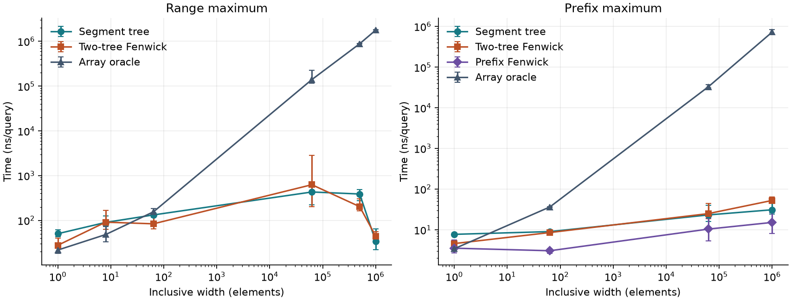
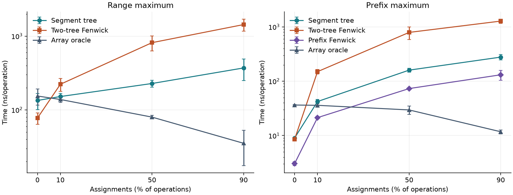
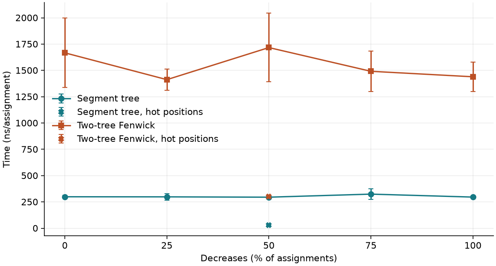
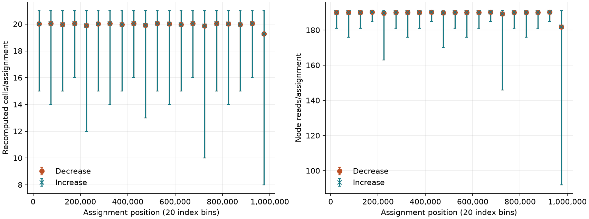
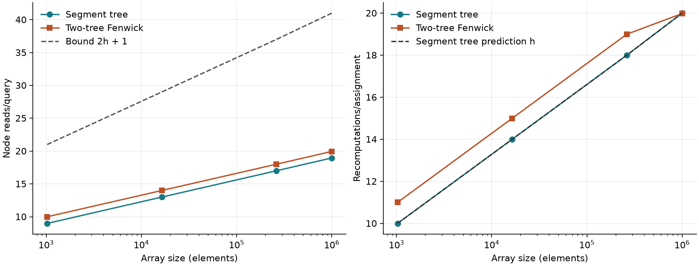
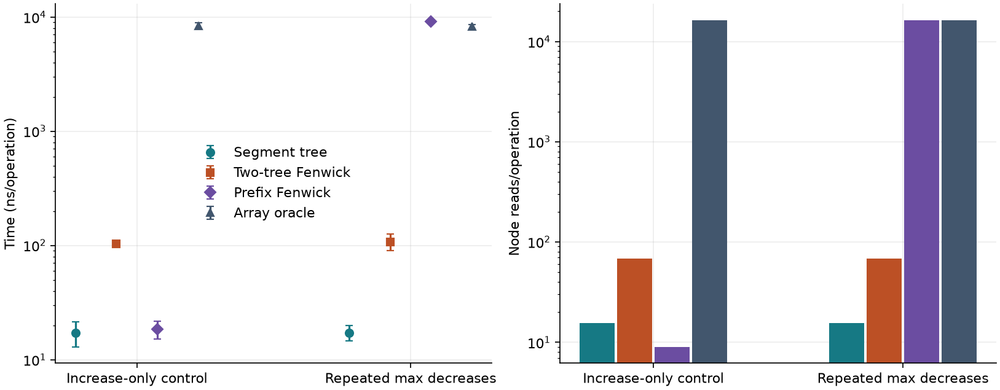
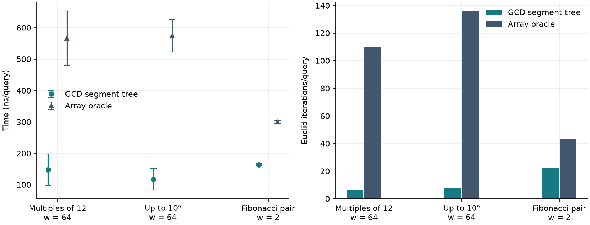

# Project 5 — Aggregates a Fenwick Tree Cannot Support

**Team Omega · CS 253 / MA 253 · Data Structures and Algorithms Laboratory**

## 1. Team and contributions

| Member | Roll no. | Role | Repository evidence |
| --- | --- | --- | --- |
| Hanchate Akhilesh Rao | 250001031 | Architect | Sensor replay and [D3 GCD derivation](https://github.com/Akhileshrao1/cs253-omega-p05/pull/6) |
| Tharun A Surana | 250001074 | Structure A | [Generic segment tree and monoids](src/structA/), [D1](docs/derivations/D1_250001074.pdf) |
| G Chetan Kumar | 250001030 | Structure B | [Dima–Ceterchi range-maximum implementation](src/structB/dima_ceterchi_max.hpp) |
| Kasireddy Pranav Karthik | 250041020 | Oracle | [Plain-array max-count, GCD and prefix oracles](oracle/oracle.cpp) |
| Koushik Reddy K | 250001041 | Adversary | [D5 generators, probes and baseline rescan model](https://github.com/Akhileshrao1/cs253-omega-p05/pull/5) |
| Thakur Tejasva Singh | 250001072 | Analyst | [Pre-measurement model](https://github.com/Akhileshrao1/cs253-omega-p05/commit/028e1fd), [harness](bench/) and [figures](results/figures/) |
| Aashish Sharma | 250041001 | Scale and reproducibility | D7 and release reproducibility role listed in [README.md](README.md) |

## 2. Problem

We study two separate arrays of up to 1,000,000 elements. Readings are used for range maximum and the frequency of that maximum. Calibration factors are used for range GCD. A sensor replay accepts point assignments on either array and prints all three answers for each range query. Assignments may increase or decrease a value. The performance study compares a segment tree, a two-tree Fenwick variant, a prefix-only Fenwick baseline, and the corresponding array scans.

For sums over a closed, 1-based range, prefix subtraction gives $P(r)-P(l-1)$. The operation depends on an inverse. Knowing that the maxima over $[1,4]$ and $[1,8]$ are both 9 cannot tell whether the maximum over $[5,8]$ is 9 or 2. Arbitrary range maximum therefore needs another decomposition.

## 3. Interface and invariants

All positions are 1-based and ranges are closed. `build` accepts a zero-based vector. An empty range has $l=r+1$ and returns the identity. The reserved max identity is `INT64_MIN`, the max-count identity is `(INT64_MIN, 0)`, and the GCD identity is 0. Calibration values lie in $[0,10^9]$.

| Structure | Queries | Representation checked |
| --- | --- | --- |
| Segment tree (max-count) | Range maximum and maximum frequency | S1–S4 cover real leaves, identity padding, parent combine and valid multiplicities. |
| Segment tree (GCD) | Range GCD | S1–S3 and S5 cover the same layout with GCD, which divides its descendants. |
| Two-tree Fenwick | Range maximum | F1 and F2 verify both kinds of blocks. F3 checks stored readings. |
| Prefix Fenwick | Prefix maximum | P1 checks the maximum of each lowbit block. |
| Array oracles | Matching operation for each structure | O1 uses a plain backing array with a valid input domain. |

The differential checks cover fixed size (G1), point values (G2), observable query behavior (G3), and the empty identity (G4). Query methods change mutable instrumentation counters. The interface defines the invariants and counter semantics in detail. [INTERFACE.md](INTERFACE.md)

## 4. Structure A — segment tree

The implementation rounds the capacity up to a power of two, pads the leaves with identities, and fills each parent from its two children. Its flat array stores children at `2k` and `2k+1`. Assignment replaces the leaf and recomputes its ancestors. Queries fold disjoint canonical blocks with separate left and right accumulators to preserve order, then merge the accumulators. The height is $h=\lceil\log_2 n\rceil$. Build takes $O(n)$, queries use $O(\log n+1)$ combines, and assignments recompute exactly $h$ ancestors for $n\ge1$.

A reading summary is ($(m,c)$). Combining two summaries keeps the one with the larger maximum and adds the two counts when their maxima match. This is associative because it produces the summary of the concatenated blocks, and concatenation is associative. The GCD tree uses the same layout with `gcd` and identity zero. A segment tree uses only associativity and an identity. It also handles lowering a former maximum without scanning its block.

If $a$ canonical nodes cover a nonempty query, this implementation records $a$ node reads and $a+1$ combines. A point assignment reads $2h$ children, writes $h+2$ cells including the raw value and leaf, and performs $h$ combines. `query_max` projects the maximum from the max-count tree, so a max-only query still pays for combining max-count records. [Implementation](src/structA/segment_tree.hpp)

### Example with a tie across blocks

For the readings `[-9, -3, -3, -9, -3]`, the padded capacity is eight. The bracketed labels below show original positions covered by the nodes.

```text
                            [1,8]
                 [1,4]                 [5,8]
           [1,2]       [3,4]      [5,6]      [7,8]
           -9  -3      -3  -9     -3   e      e   e
```

The query `[2,5]` uses `[2,2]`, `[3,4]`, and `[5,5]`. Each block contributes `(-3,1)`, giving `(-3,3)`. Assigning `-8` to position 5 changes the leaf and three ancestors. The next query still returns `-3` with count 2. The reserved identity in positions 6–8 allows the same combine rule throughout the tree.

The generic interface also preserves order for a noncommutative monoid, as the smoke tests exercise with string concatenation. The separate raw-values array lets the invariant checker compare leaves with the last assigned values. A sparse table would fit read-only associative and idempotent aggregates, but repeated assignments would invalidate its precomputed ranges. The segment-tree representation handles updates with one path and supports the non-idempotent max-count combine.

## 5. Structure B — two-tree Fenwick and prefix baseline

Let $b(i)=i\,\&\,(-i)$. Structure B stores the raw readings and two arrays of blocks. Cell $i$ of the first tree stores the maximum over $[i-b(i)+1,i]$. The second stores the maximum over $[i,\min(n,i+b(i)-1)]$. The build propagates maxima in opposite directions across the two trees in $O(n)$. A query consumes blocks from both endpoints until the walks meet, then reads the remaining value directly. Each walk has logarithmic length.

An assignment updates the raw reading, then rebuilds both ancestor paths. The implementation combines the new value with maxima from blocks on either side of it, including single raw readings at some boundaries. It reuses running side maxima within each path. It performs the same structural steps whether the value rises or falls. With $F$ rebuilt cells and $T$ neighbor reads, the update records $F+1$ writes and $T+2F$ combines. $F=O(\log n+1)$, and an upper bound obtained by charging $O(\log n+1)$ block reads to each affected cell is $O((\log n+1)^2)$. The experiment reports $F$ and $T$ individually. [Implementation](src/structB/dima_ceterchi_max.hpp)

The prefix baseline uses one tree and the raw array. A prefix query traverses one cell per set bit of its endpoint. An increase can propagate by taking the maximum with the new value. A decrease that matched an ancestor's saved maximum triggers a rescan of that ancestor's raw block. If $f$ cells are on the point's path, $B$ of them rebuild, and their block lengths sum to $S$, the decrease records $R=1+f+S$ reads, $W=1+B$ writes and $C=S$ combines. The lowbit at least doubles along the path, so $S<2n$, with $\Theta(n)$ work possible on one decrease. This is the full-block rescan strategy from the D5 simulator. [Baseline implementation](src/structB/prefix_max_fenwick.hpp)

### Example of an endpoint walk and repair

For a query over `[5,13]` with at least 13 readings, the forward and reverse walks meet at position 8.

| Query contribution | Source | Included positions |
| --- | --- | --- |
| Advance from 5 to 6 | Reverse block at 5 | `[5,5]` |
| Advance from 6 to 8 | Reverse block at 6 | `[6,7]` |
| Meeting value | Raw entry at 8 | `[8,8]` |
| Retreat from 12 to 8 | Standard block at 12 | `[9,12]` |
| Retreat from 13 to 12 | Standard block at 13 | `[13,13]` |

These five pieces cover the closed interval exactly once. To repair a block after writing position 8, any affected block combines the new value with the maxima strictly to its left and right within that block. Every saved region used for the side maxima excludes position 8. The maxima remain valid during rebuild, so a block that previously got its maximum from position 8 can correctly switch to a different reading.

A single prefix tree can represent `[1,r]` by removing set bits from the endpoint. A second tree supplies the missing orientation for an interior range. This costs one additional array of cached maxima and gives the two-tree method a more involved update than the segment tree's single path. Structure B stores scalar maximum values. Recovering their frequencies would require additional aggregate information.

## 6. Beyond the lecture

Dima and Ceterchi present range **minimum** using two binary indexed trees whose block orientations are reversed. The same interval decomposition works for maximum by using the maximum operator and its identity. The paper describes reusing side aggregates to achieve logarithmic amortized updates and reports that its two-tree design was faster for queries and updates than its own segment tree. This checkout unconditionally rebuilds both ancestor paths, and consuming a singleton at a boundary can restart a side walk. Section 11 compares the resulting counter growth. [Dima and Ceterchi, §2.3–2.5](https://ioinformatics.org/oi/pdf/v9_2015_39_44.pdf)

For GCD, the coarse argument gives $O(\log n\log V)$ for $n,V\ge2$, because there are $O(\log n)$ combines. In either accumulator, let $g_{j-1}>0$ be the running GCD before a new summary and $g_j>0$ be the new one. Euclid's work is $O(1+\log(g_{j-1}/g_j))$, up to an initial step to put its operands in decreasing order. Multiplying these ratios telescopes, so the log terms sum to at most $\log V$ in each accumulator. Zero operands cost constant work, and the final merge costs $O(\log V)$. This gives $O(\log n+\log V)$ per range query. [D3](docs/derivations/D3_250001031.pdf)


## 7. Correctness

The oracle stores the last assigned value at every position and scans the requested interval. This is a direct implementation of each operation's specification. The candidate replay compares each query answer with the oracle and checks the old and new point values around each assignment. Full static queries beyond the scan budget use a separate sliding-window maximum calculation, cross-checked against the literal array oracle on the matched prefix.

Four seeded streams of 1,000,000 operations over 1,000,000 elements covered max, max-count, GCD, and prefix max. They used seeded assignments, reads at array boundaries, widths from zero to 64, and both value directions where applicable. Each relevant candidate passed the seven suite/structure combinations with invariants checked after build, after every 1,000 operations, and at completion. The small edge suite checked every operation, including a tied maximum split across leaves, negative readings, zero calibration values, endpoint updates, singleton queries and empty ranges. No mismatches occurred in the differential or timed workloads. [Verification log](results/raw/checks.csv)

The harness saves the first failing prefix and a reduced replay if a comparison or invariant check fails. The reducer holds the initial array fixed, preserves the failure message, and tries up to 64 deletions. A reduced trace is a diagnostic and may admit further reductions. [Replay instructions](bench/README.md#results-and-debugging)

| Date | Module | Symptom | How found | Fix |
| --- | --- | --- | --- | --- |
| 19 Nov 2026 | D5 baseline simulator | A finite sentinel could override valid readings below it. | Adversary module review of negative inputs | [Use the reserved minimum identity](https://github.com/Akhileshrao1/cs253-omega-p05/commit/a11cbcc) |

## 8. Adversarial inputs

| Experiment | Construction | Measured effect |
| --- | --- | --- |
| E5 high-step query | Probe all endpoints with left endpoint 1 and repeat the first one with the highest B count. | `[1, 786431]` reached 38 B reads and combines per query. The segment tree read 19 nodes. The literal oracle checked the first 127 queries. |
| E5 hot assignments | Probe a decrease and restoration at every index. Rank by rebuilt cells, then reads. Cycle through the 16 selected indices to remove unique maxima in descending order, then restore them. | The chosen positions were the odd indices 1 through 31. Each B update rebuilt 21 cells and read 190 neighbors, in either direction. |
| E6 stale prefix maximum | On 32,768 values, alternately decrease and restore the unique maximum at index 1. Query the entire prefix after each assignment. Compare with the same position and query pattern with increases only. | Each decrease rebuilt 16 cells and scanned 65,535 raw values. The 1,024 decreases rebuilt 16,384 cells and inspected 67,107,840 raw values in repair alone. |

The high-step query searches the left-anchored family. The D5 module also has an exhaustive all-pairs search for small arrays. The hot update score prioritizes the number of rebuilt cells. The separate read maximum of 191 occurs at other positions. [Selected parameters](results/raw/targets.csv) · [D5 tools](adversary/)

An increase-only propagation rule keeps the previous maximum whenever the new reading is smaller. The E6 decrease invalidates that maximum at every ancestor of index 1. Rescanning restores P1. At this power-of-two size the affected block widths sum to $1+2+\cdots+32768=65535$, while the number of cells is only 16. [Assignment work histograms](results/raw/update_work.csv)

## 9. Predicted cost model

The predicted-cost model was committed before these timings. Its time model relates fixed overhead and machine-specific coefficients to reads $R$, writes $W$, combines $C$, recomputations $B$, and an error term. Euclid iterations are tracked separately for GCD. The benchmark uses these counters to test structural predictions. Timing coefficients were left unfitted because several counters change together. [Original model](https://github.com/Akhileshrao1/cs253-omega-p05/commit/028e1fd) · [Standalone D6](docs/derivations/D6_250001072.pdf)

| Operation | Predicted work |
| --- | --- |
| Array scan | Exactly $w$ reads per range query. One stored value changes on assignment. |
| Segment-tree queries | At most about two boundary paths across $h=\lceil\log_2 n\rceil$ levels. Actual reads are the number of canonical nodes. |
| Segment-tree assignment | Exactly $h$ rebuilt ancestors, regardless of direction. At $n=10^6$, one million assignments rebuild 20,000,000 cells. |
| Two-tree Fenwick query | Two logarithmic endpoint walks and one raw value. $2h+1$ bounds the counted reads in the plotted size sweep. |
| Two-tree Fenwick assignment | Logarithmically many affected cells. The model tracks repair reads, writes and combines separately. |
| Prefix maximum | Prefix walks cost $\operatorname{popcount}(r)$. Decreases may additionally rescan stale blocks. |
| GCD query | The segment tree's $O(\log n+\log V)$ bound accounts for the telescoping Euclid cost. |

At widths 1, 8, 64, 62,500, 500,000 and 1,000,000, one million literal scans would read respectively $10^6$, $8\times10^6$, $64\times10^6$, $6.25\times10^{10}$, $5\times10^{11}$, and $10^{12}$ values. The original segment-tree estimate used roughly 40 path steps as an upper planning scale at $n=10^6$. Actual counted reads vary with width and alignment. The crossover hypothesis was that scan time grows with width while tree time depends on the cover and implementation constants.

## 10. Experimental setup

| Item | Recorded setting |
| --- | --- |
| Machine | Lenovo 82K1, Intel Core i5-11320H at 3.20 GHz nominal, 4 physical cores and 8 logical CPUs, 7.79 GiB usable RAM |
| Caches | L1 48 KiB data and 32 KiB instruction per core, L2 1,280 KiB per core, L3 8,192 KiB shared |
| OS and process | Windows 11 build 26320 ×64, Balanced power scheme, single benchmark thread, OS scheduling |
| Compiler | GCC 15.2.0, MSYS2 MinGW-w64 UCRT, `-std=c++17 -O3 -DNDEBUG -Wall -Wextra -pedantic` |
| Trials | 1 discarded warm-up and 7 recorded runs for each case/variant/batch length. Trial order rotates between variants. |
| Seed and data | D5 SplitMix64, seed `20261119`. Readings generally use integers from −1,000,000 to 1,000,000. Ties use −3 to 3. GCD cases use multiples of 12, values up to $10^9$ with zeros, and consecutive Fibonacci values. |
| Profiler | WPR listed the LLC-miss event. Xperf returned “Failed to configure counters.” Cache-miss counts were unavailable. |

Each trial times the build and operation batch separately with a steady clock. Structures are called by concrete type, with the same stored operation trace, counters enabled, and checksum validation. Checking, trace generation and plotting are outside the timed operation batch. The full C++ run took about 6 minutes 17 seconds. [Environment and source hashes](results/environment.json)

| Cases | Timed workloads |
| --- | --- |
| E1, E2 | Range maximum width sweep, then width-64 queries with 0%, 10%, 50%, or 90% assignments |
| E3–E5, E9 | Assign-only traces sweeping the decrease fraction, plus high-step queries and hot updates |
| E6 | Prefix queries by width, width-64 assignment mixes, and the 4,096-operation rescan/control pair |
| E7 | Max-count on ties, widths 8 and 64, with 20% assignments |
| E8 | GCD on three data profiles, with an additional width-64 mixed trace at 50% assignments |
| E10 | Size sweep at 1,024, 16,384, 262,144 and 1,000,000 elements, half-width queries or assignments |

The principal traces use 1,000,000 operations on 1,000,000 elements. The smaller E10 sizes use 200,000 operations each. Each array-oracle trial is capped at 100,000,000 queried elements. When the cap binds, all variants also time the same shortened prefix. In E1, the three widest traces match on 1,600, 200 and 100 queries. The indexed variants additionally execute all 1,000,000 queries. The CSVs record the mode, batch length, update directions and seed for every trial.

## 11. Results

Timing summaries below use the arithmetic mean ± sample standard deviation across seven runs. The [summary table](results/summary.csv) also gives the minimum and maximum batch time and all five work counters. Each figure can be reproduced with [results/plot.py](results/plot.py). All experiments use seed `20261119`.

### Width and update mix



**Figure 1.** Mean matched-query time by width on log axes, with min–max bars across seven trials. The array is competitive for narrow ranges and pays for every scanned element. The shortest wide-range batches have visibly higher relative spread. Data [E1](results/raw/E1.csv) and [E6](results/raw/E6.csv), plotted by `results/plot.py`.

| Range-max workload | Segment tree, ns/query | Two-tree Fenwick, ns/query | Array, ns/query |
| --- | ---: | ---: | ---: |
| Width 1, 1,000,000 queries | 50.52 ± 6.82 | 27.83 ± 5.92 | 21.78 ± 4.13 |
| Width 8, 1,000,000 queries | 90.18 ± 19.50 | 91.37 ± 36.12 | 48.31 ± 15.76 |
| Width 64, 1,000,000 queries | 132.66 ± 11.79 | 83.99 ± 23.64 | 155.71 ± 17.33 |
| Width 62,500, 1,000,000 indexed queries | 299.35 ± 43.93 | 160.70 ± 39.25 | See matched batch of 1,600 |
| Width 500,000, 1,000,000 indexed queries | 260.63 ± 12.38 | 96.05 ± 6.49 | See matched batch of 200 |
| Width 1,000,000, 1,000,000 indexed queries | 17.96 ± 0.67 | 25.18 ± 0.55 | See matched batch of 100 |

By mean time, the oracle-to-tree crossover lies between the tested widths 8 and 64. At width 500,000 the two-tree Fenwick was about **2.7× faster** than the segment tree on the million-query trace. It also won at widths 1, 64 and 62,500. Both structures handled width 8 with overlapping spread. The segment tree won at full width with 7 canonical reads, while B used 26. The full-width query repeatedly uses one endpoint pair. At half width, B won with slightly more logical reads (19.95 versus 18.95). The implementations use different traversal loops and different aggregate payloads. The timings cannot isolate their individual effects.



**Figure 2.** Width-64 workloads as the assignment share rises. The time axis is logarithmic. B leads A for the range-query-only batch, then loses at every tested nonzero update share. Data [E2](results/raw/E2.csv) and [E6](results/raw/E6.csv), plotted by `results/plot.py`.

| Assignments | A, ns/operation | B, ns/operation | Array, ns/operation |
| --- | ---: | ---: | ---: |
| 0% | 134.32 ± 33.19 | 77.65 ± 13.74 | 154.26 ± 37.91 |
| 10% | 151.81 ± 15.17 | 222.65 ± 43.53 | 138.43 ± 12.31 |
| 50% | 228.05 ± 25.13 | 815.95 ± 186.05 | 79.88 ± 4.45 |
| 90% | 370.62 ± 120.77 | 1,434.95 ± 266.44 | 35.26 ± 17.66 |

At 50% assignments, B used 98.35 reads and 118.33 combines per operation, while A used 23.01 reads and 13.51 combines. The array gets cheaper as scans are replaced by constant-work assignments. The prefix Fenwick led the indexed implementations across the tested width-64 prefix mixes. It benefits from a one-cell prefix decomposition at endpoint 64. The array had the lowest mean time at 50% and 90% assignments in that prefix trace.

### Recomputations, decrease direction and size



**Figure 3.** Assign-only timing with matched position streams. Cross markers show the trace that repeats just 16 hot positions. Data [E3](results/raw/E3.csv), [E4](results/raw/E4.csv), [E5](results/raw/E5.csv) and [E9](results/raw/E9.csv), plotted by `results/plot.py`.

At random positions, B averaged 189.70 reads, 20.98 writes, 229.66 combines and 19.98 rebuilt cells per assignment. The increase-only and decrease-only traces had identical counter distributions. B's 95th percentiles and maxima were 191 reads, 22 writes, 232 combines and 21 rebuilds. In the hot trace, B increased its rebuild count to 21 and averaged 301.06 ± 6.07 ns/assignment, versus 1,717.09 ± 326.28 ns on the random 50%-decrease trace. A fell from 295.22 ± 13.61 ns to 29.18 ± 0.51 ns on the same change. Repeated positions change memory access patterns and timing. The experiment isolates position reuse and work counters, while the cache contribution remains unmeasured. [Distribution data](results/raw/update_work.csv)



**Figure 4.** Paired position probe for B. Each marker averages sampled positions in one bin and the bars span their min–max counter values. Increase and decrease points overlap. This is a deterministic diagnostic of position dependence. Data [index probe](results/raw/index_probe.csv), plotted by `results/plot.py`.



**Figure 5.** The half-width query's node reads track the logarithmic bounds. The assignment rebuild count matches height for A and grows at a similar rate for B. The size axis is logarithmic. The work counters repeat exactly across the seven timed runs. Data [E10](results/raw/E10.csv), plotted by `results/plot.py`.

| $n$ | A / B reads per half-width query | A / B rebuilt cells per assignment | A / B reads per assignment |
| ---: | ---: | ---: | ---: |
| 1,024 | 8.99 / 10.00 | 10 / 11.00 | 20 / 55.00 |
| 16,384 | 13.00 / 14.00 | 14 / 15.00 | 28 / 105.00 |
| 262,144 | 17.00 / 18.00 | 18 / 19.00 | 36 / 171.00 |
| 1,000,000 | 18.95 / 19.95 | 20 / 19.98 | 40 / 189.70 |

The largest structural gap was B's repair work. At the three power-of-two sizes, average reads were close to $h(h+1)/2$. This is consistent with repeated boundary work in the nested repair loops and the implementation's quadratic-in-height upper bound from §5. A tight bound requires a proof of the side-walk recurrence. At one million elements, similar numbers of rebuilt cells hid a **4.74×** difference in reads. This extra work helps explain B's slower updates in the current implementation and workload. [E10 trials](results/raw/E10.csv) · [Paper, §2.4–2.5](https://ioinformatics.org/oi/pdf/v9_2015_39_44.pdf)

### Baseline rebuilds, maximum frequency and GCD



**Figure 6.** The prefix Fenwick pays the raw rescan cost once for each stale block. The y-axes are logarithmic. Data [E6](results/raw/E6.csv), plotted by `results/plot.py`.

The prefix baseline's 4,096-operation control averaged 18.44 ± 3.21 ns/op. In the rescan trace that rose to 9,154.11 ± 249.53 ns/op. The segment tree averaged 17.21 ± 2.69 ns/op on the same rescan trace. For an individual decrease the baseline recorded 65,552 reads, 65,535 combines, 17 writes and 16 recomputations, matching the block-width model.

On the width-64 max-count trace with 20% assignments, the segment tree took 188.45 ± 40.91 ns/op and the oracle took 135.15 ± 12.23 ns/op. The corresponding read counts were 12.81 and 51.40 per operation. The oracle won on this short-interval mix even with more reads. The segment tree spends additional work on updates and combines two-field summaries. [Max-count trials](results/raw/E7.csv)



**Figure 7.** The two Fibonacci neighbors force more Euclid iterations in the tree despite the two-element query. Matched, one million queries per series. Data [E8](results/raw/E8.csv), plotted by `results/plot.py`.

At width 64, the GCD tree averaged 6.70 Euclid iterations per query for the small multiples and 7.79 for the wider numeric domain. The consecutive Fibonacci case used 22.47 iterations on the tree and 43.50 on the oracle. Many wide-range tree nodes already contain small GCDs, which limits subsequent Euclid work. This accounts for the operation-count difference. The small and large width-64 timing spreads overlap. The Fibonacci case also changes width and alignment, and serves as a stress diagnostic.

### Build time

| Variant and representative case | Mean build time ± SD (ms) | Min–max (ms) |
| --- | ---: | ---: |
| Max-count segment tree, E2 query-only | 25.68 ± 4.44 | 21.67–35.04 |
| Two-tree Fenwick, E2 query-only | 18.74 ± 2.13 | 15.45–20.80 |
| Array, E2 query-only | 5.10 ± 0.57 | 4.30–5.95 |
| Prefix Fenwick, E6 width 64 | 8.63 ± 1.08 | 7.77–10.28 |
| GCD segment tree, E8 large | 52.83 ± 4.65 | 47.46–59.04 |

The build timer includes initialization and allocation for a new instance. Build counters are reset at the start of each timed operation batch. The CSV work totals correspond to the replay only.

## 12. D7 memory footprint and reproducibility

This measurement separates structure-owned array payload, the sensor input arrays, and whole-process peak resident memory. It uses $n=1{,}000{,}000$ and padded segment-tree capacity $\operatorname{cap}=1{,}048{,}576$. `Value` is `int64_t` (8 bytes); this GCC build reports `sizeof(MaxCount) = 16` bytes.

For Structure A, each segment tree owns $2\operatorname{cap}$ summary values and $n$ original values. Its logical-size model is $2\operatorname{cap}\cdot\operatorname{sizeof}(T)+n\cdot\operatorname{sizeof}(Value)$. Structure B's two-tree range-maximum implementation owns three $(n+1)$-element `Value` vectors; its prefix baseline owns two. The observed payload is computed from each vector's `capacity()` and element size. The model uses logical element counts and excludes allocator metadata.

### Structure array payload

| Structure-owned arrays | Model bytes | Observed payload bytes | Observed bytes per input element |
|---|---:|---:|---:|
| A max-count tree | 41,554,432 | 41,554,432 | 41.554432 |
| A GCD tree | 24,777,216 | 24,777,216 | 24.777216 |
| A sensor application (both A trees) | 66,331,648 | 66,331,648 | 66.331648 |
| B two-tree range maximum | 24,000,024 | 24,000,024 | 24.000024 |
| B prefix baseline | 16,000,016 | 16,000,016 | 16.000016 |
| B range maximum plus separate A GCD tree | 48,777,240 | 48,777,240 | 48.777240 |

At this input size, observed vector-capacity payload equals the logical-size model for every structure row. This equality applies to the vector payload only; it does not include allocator metadata or process overhead.

### Inputs and whole-process peak

| Category | Bytes | Meaning |
|---|---:|---|
| Readings input array | 8,000,000 | One million 8-byte values |
| Calibration input array | 8,000,000 | One million 8-byte values |
| Both input arrays | 16,000,000 | Kept separate from structure arrays |
| Whole-process peak RSS | 126,160,896 | All input arrays and reporter variants exist together; includes runtime and other process memory |

The process peak is a separate measurement and must not be read as the footprint of one structure or one application. The Linux runner reports peak RSS through `getrusage`; it is expected to include more than the explicitly counted vector payloads.

### Hosted measurement record

The memory run started at `2026-11-20 13:07:15 UTC` on the GitHub-hosted Ubuntu 26.04.1 runner. The VM reported an Intel Xeon Platinum 8573C, one physical core, two logical CPUs, and 7.75 GiB RAM. It used GCC 15.2.0 and Python 3.12.16. The deterministic inputs were `readings[i] = i % 100003` and `calibration[i] = i % 1000000001`; no random seed was used for this memory-only run.

Reproduce the memory measurement from the repository root with:

```text
python bench/run_memory.py --n 1000000 --out build/benchmark/memory_footprint.csv
```

The runner recorded the exact compile command and measurement command in [`results/raw/memory_footprint.environment.json`](results/raw/memory_footprint.environment.json). Raw output is in [`results/raw/memory_footprint.csv`](results/raw/memory_footprint.csv). The workflow that builds, runs smoke checks, and measures memory is [`.github/workflows/ci.yml`](.github/workflows/ci.yml).

The separate full-scale benchmark has **not yet been run**. Its planned command is `python bench/run.py --all --profile full --runs 5 --seed 20261119 --out build/benchmark/full`. The workflow's `full-scale-reproduction` job runs only for `workflow_dispatch`; the workflow must first be available on the repository's default branch before GitHub can dispatch it. The full-scale input size, machine, compiler, command, and result must be recorded from that run and kept separate from this memory-only measurement.

The individual derivation and run record for Aashish Sharma (250041001) is in [`docs/derivations/D7_250041001.pdf`](docs/derivations/D7_250041001.pdf).

## 13. Limitations

- These results represent one Windows machine and one seed across a matrix of synthetic traces. Use multiple seeds and randomized case order on the grading machine to estimate sensitivity to trace and run order.
- The widest matched batches have only 100–1,600 operations. Use the million-query rows to compare the indexed structures at those widths. The short matched batches provide the bounded comparison with the literal array.
- The profiler attempt yielded no cache data. Repeat selected query and update traces with permitted hardware counters before attributing timing differences to cache misses.
- The grader's exact command-line format should be confirmed with the Architect before tagging. The stale standalone oracle self-test depends on a missing header. The integrated differential suite covers the tested implementations. [Run instructions](bench/README.md)

## 14. References

1. P. M. Fenwick, “A new data structure for cumulative frequency tables,” *Software: Practice and Experience*, 24(3), 327–336, 1994.
2. M. Dima and R. Ceterchi, “Efficient range minimum queries using binary indexed trees,” *Olympiads in Informatics*, 9, 39–44, 2015. [Paper](https://ioinformatics.org/oi/pdf/v9_2015_39_44.pdf)
3. M. de Berg, O. Cheong, M. van Kreveld, and M. Overmars, *Computational Geometry: Algorithms and Applications*, 3rd ed., 2008, Ch. 10.
4. J. L. Bentley, “Decomposable searching problems,” *Information Processing Letters*, 8(5), 244–251, 1979.
5. D. E. Knuth, *The Art of Computer Programming*, Vol. 2, 3rd ed., 1997, §4.5.3.
6. CS 253 / MA 253 course materials, Project 5 description and lab submission guidelines.
7. [Tool declaration](TOOLS.md) · [Benchmark reproduction](bench/README.md).
